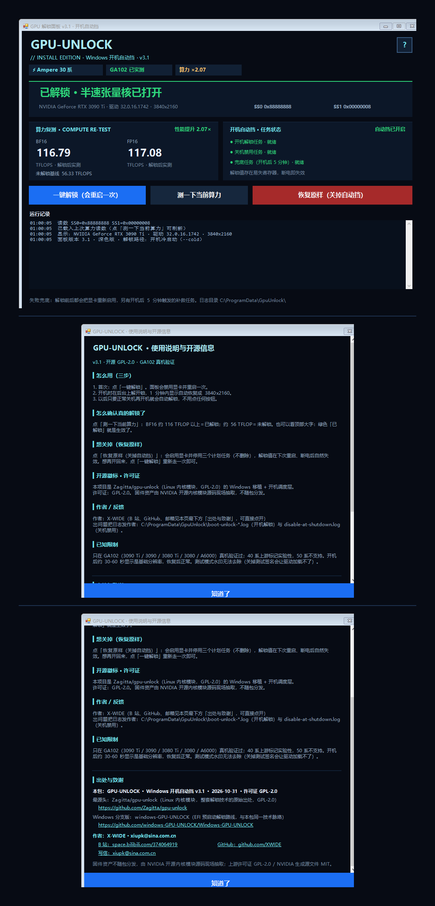

# GPU Unlock · Windows Boot-Time Edition

[中文](README.md) | **English**

Unlocks the half-rate tensor cores that vendors lock on Ampere (RTX 30 series) cards — under Windows, with your existing driver:
**BF16/FP16 throughput ≈ ×2**. No VBIOS flash, no driver replacement, no USB stick, no boot-configuration changes.
The unlock happens on **every boot, before the NVIDIA driver binds the card**.

Measured on an RTX 3090 Ti, driver 617.42, Windows 10 19041 (median of 3 runs):

| | Locked | Unlocked |
|---|---|---|
| BF16 TFLOPS | 56.33 | **116.79** |
| FP16 TFLOPS | 57.00 | 117.08 |
| Speed-up | 1.00× | **2.07×** |



---

## Which cards are supported (read this first)

| Chip | Cards | Status |
|---|---|---|
| **GA102** | 3090 Ti / 3090 / 3080 Ti / 3080 / A6000 | ✅ **validated on real hardware** (this project was developed and measured on one) |
| GA104 / GA106 / GA107 | 3070 / 3060 Ti / **3060** | ❌ **not possible** — see below, do not try |
| Ada (RTX 40) | 4070 / 4080 / 4090 … | ⚠️ upstream marks it experimental; not validated here |
| Blackwell (RTX 50) | 50xx | ❌ unsupported upstream |

### Why 3060 / 3070 cannot work (measured 2026-11-01, not a guess)

The unlock has to boot the GSP **itself, before the NVIDIA driver binds the card**, which requires the **per-chip BooterLoad data**. Three sources were checked:

1. **NVIDIA's open kernel module sources** (`NVIDIA-kernel-module-source-610.43.03.tar.xz`, 3868 entries): that data exists for only five chips — `TU116 / TU102 / AD102 / GA102 / GA100`. **No GA104 / GA106 / GA107.**
2. **The official driver installer** (`NVIDIA-Linux-x86_64-610.43.03.run`, 440 MB, 1189 entries once unpacked): it carries only the generic `firmware/gsp_ga10x.bin` (84 MB), `gsp_tu10x.bin`, `ucodes_ga10x.bin`, `ucodes_tu10x.bin`. Members matching `ga104/ga106/ga107`: **0**. Members matching `booter`: **0**.
3. **The upstream extractor** (`firmware/extract_gsp.py`): also only pulls those two generic blobs out of the `.run`; every per-chip boot asset comes from the open module sources.

The generic blob cannot substitute: `gsp_ga10x.bin` is the GSP **runtime** firmware, while **starting** the GSP needs the chip-specific booter. So on a 3060 this is not a misconfiguration and not "not ported yet" — **the data does not exist**.

> 3060 / 3070 / 3060 Ti owners: there is nothing in this repository that will work on your card. Do not spend time downloading it.

---

## What this repository is

Upstream [Zagitta/gpu-unlock](https://github.com/Zagitta/gpu-unlock) is a Linux kernel module that unlocks the card
from the initramfs, before the driver binds. This project is a **Windows port + a boot-time scheduler layer** on top of it:

1. `windows/` — user-mode CLI `gpu_unlock.exe` (UAC, service registration, device I/O, reporting)
2. `kernel/gpu_unlock/` — shared unlock engine (BAR mapping, register access, PCIe FLR, GSP transaction)
3. `windows/driver/` — kernel helper `gpuunlock.sys` (mechanical only: map BAR, DMA, config space, FLR)
4. `installer/` — three Windows scheduled tasks + a GUI panel that turns "unlock at boot" into an unattended setup

**Why it must run at boot**: unlocking means writing two volatile selectors
(`SS0 (+0x82381c)=0x88888888`, `SS1 (+0x823820)=0x8`) plus one PCIe FLR.
Once Windows is up and `nvlddmkm` owns the GPU, the GSP firmware is already running and the write is rejected:
`unlock_transaction_gfw error=-138 ... firmware_started=0`. That is the single reason a "click to unlock" button can never
succeed on a running system.

## Layout

| Path | Contents |
|---|---|
| `docs/` | upstream documentation (Linux history, background) + UI screenshots |
| `firmware/` | `extract_boot_assets.py`: builds the Booter/GSP boot assets from NVIDIA's generated sources |
| `kernel/gpu_unlock/` | unlock engine C sources (`unlock_610.c`, `gfw_eval.c`, `layout_610.c`, …) |
| `windows/` | CLI, HAL, driver sources, Linux API shim |
| `tests/` | engine unit tests (mock HAL) |
| `installer/` | **start here for end users**: `README.md`, install/uninstall scripts, `extract-assets.py`, `scripts/` |
| `licenses/` | full text of third-party licenses |
| `tools_*.ps1` | build scripts (driver / exe / signing / release staging) |

## Build

Requires **Visual Studio Build Tools 2022 + Windows Driver Kit 10.0.22000.0**:

```powershell
$env:GU_KITS = 'C:\Program Files (x86)\Windows Kits\10'
powershell -File tools_build_drv.ps1    # -> build\gpuunlock.sys
powershell -File tools_build_exe.ps1    # -> build\gpu_unlock.exe
powershell -File tools_sign.ps1         # self-sign (testsigning required)
```

## Install (end users)

One all-in-one package is attached to the [Releases](https://github.com/XWIDE/X-WIDE-gpu-unlock-win/releases) page:

| Asset | Use |
|---|---|
| `GPU-UNLOCK-v3.1.1-full.zip` (~70 MB) | everything: binary, driver, certificate, firmware, GUI panel, installer, **and full sources** |

The package ships `如何安装.txt` (Chinese step-by-step) and `INSTALL.bat`, and the same sources are in the repo for audit.
Short version: run `enable-test-signing.ps1` (imports the bundled certificate and enables test signing) → reboot →
run `INSTALL.bat` (or `installer\install.ps1`) → shut down (not restart) and power on.
See also [`installer/README.md`](installer/README.md).

## Status

| Item | Status |
|---|---|
| GA102 (3090 Ti / 3090 / 3080 Ti / 3080 / A6000) | **validated on real hardware** (cold-boot path, fully automatic 3-task loop) |
| GA102 firmware assets reproducible | **validated**: the 3 blobs produced by `extract-assets.py` from the official 610.43.03 sources are byte-identical to the released ones |
| ga104 / ga106 / ga107 (3070 / 3060 Ti / 3060) | ❌ not possible — evidence in the "Which cards are supported" section above |
| Ada (RTX 40) | upstream marks it experimental; not validated here |
| Blackwell (RTX 50) | unsupported |
| Multi-GPU / sleep-resume | not implemented |

## License

GPL-2.0 (full text in `LICENSE`). Third-party components and the NVIDIA firmware redistribution limits are described in
`NOTICE.md`; **firmware blobs are not committed** — generate them locally with `installer/extract-assets.py`.

`README.upstream.md` / `README.upstream.zh-CN.md` are the original upstream notes (Linux side), kept for reference.
