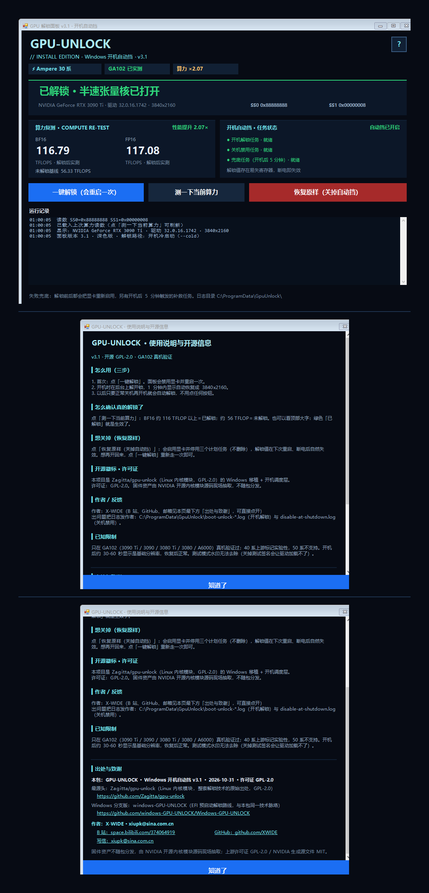

# GPU 解锁 · Windows 开机自动挡

**中文** | [English](README.en.md)

让 Ampere（RTX 30 系）显卡在 Windows 上打开被厂商锁住的半速张量核：**BF16/FP16 算力约 ×2**。
不刷 VBIOS、不换驱动、不用 U 盘、不改引导；解锁发生在每次开机、NVIDIA 驱动绑定显卡之前。

实测（RTX 3090 Ti / 驱动 617.42 / Windows 10 19041 / 3 次取中位）：

| | 未解锁 | 解锁后 |
|---|---|---|
| BF16 TFLOPS | 56.33 | **116.79** |
| FP16 TFLOPS | 57.00 | 117.08 |
| 倍数 | 1.00× | **2.07×** |



---

## 这个仓库是什么

上游 [Zagitta/gpu-unlock](https://github.com/Zagitta/gpu-unlock) 是 Linux 内核模块，
在 initramfs 里、驱动绑定前解锁显卡。这个东西是它的 **Windows 移植 + 开机调度层**：

1. `windows/` —— 用户态命令行 `gpu_unlock.exe`（UAC、服务注册、设备 I/O、结果报告）
2. `kernel/gpu_unlock/` —— 共享解锁引擎（BAR 映射、寄存器读写、PCIe FLR、GSP 事务）
3. `windows/driver/` —— 内核辅助驱动 `gpuunlock.sys`（只做机械动作：映射 BAR、DMA、配置空间、FLR）
4. `installer/` —— 三个 Windows 计划任务 + 图形面板，把「开机解锁」变成无人值守

**为什么必须在开机时做**：解锁＝往两个易失选择器写值（`SS0 (+0x82381c)=0x88888888`、`SS1 (+0x823820)=0x8`）+ 一次 PCIe FLR。
等 Windows 起来、`nvlddmkm` 接管后，GSP 固件已经在跑，写入被拒：
`unlock_transaction_gfw error=-138 ... firmware_started=0`。这是运行中"一键解锁"永远失败的唯一原因。

## 目录

| 路径 | 内容 |
|---|---|
| `docs/` | 上游文档（Linux 侧历史、原理图） |
| `firmware/` | `extract_boot_assets.py`：从 NVIDIA 生成源码造 Booter/GSP boot 资产 |
| `kernel/gpu_unlock/` | 解锁引擎 C 源码（`unlock_610.c`、`gfw_eval.c`、`layout_610.c` …） |
| `windows/` | CLI、HAL、驱动源码、Linux API shim |
| `tests/` | 引擎单元测试（mock HAL） |
| `installer/` | **普通用户看这里**：`README.md` 方案说明、`安装.ps1`、`卸载.ps1`、`extract-assets.py`、`scripts/` 调度脚本 |
| `licenses/` | 第三方许可证全文 |
| `tools_*.ps1` | 构建脚本（驱动 / exe / 签名 / 暂存发布树） |

## 构建

需要 **Visual Studio Build Tools 2022 + Windows Driver Kit 10.0.22000.0**：

```powershell
$env:GU_KITS = 'C:\Program Files (x86)\Windows Kits\10'
powershell -File tools_build_drv.ps1    # -> build\gpuunlock.sys
powershell -File tools_build_exe.ps1    # -> build\gpu_unlock.exe
powershell -File tools_sign.ps1         # 自签名（需 testsigning）
```

## 安装（普通用户）

见 [`installer/README.md`](installer/README.md)。三步：关 Secure Boot → 开测试签名 → 跑 `安装.ps1`，然后正常关机再开机。

## 状态

| 项 | 状态 |
|---|---|
| GA102（3090 Ti / 3090 / 3080 Ti / 3080 / A6000） | **真机验证通过**（冷启动路径 + 三任务全自动闭环） |
| GA102 固件资产可复现 | **验证通过**（`extract-assets.py` 从官方 610.43.03 源码抽出的 3 个 blob 与发布版逐字节相同） |
| ga104 / ga106 / ga107（3070 / 3060 Ti / 3060） | 未实现：NVIDIA 开源源码里没有这些芯片的生成文件，需走驱动挖固件路线 |
| Ada（40 系） | 上游标实验性；本仓库未验证 |
| Blackwell（50 系） | 不支持 |
| 多卡 / 睡眠恢复 | 未实现 |

## 许可证

GPL-2.0（全文 `LICENSE`）。第三方组件、NVIDIA 固件的再分发限制见 `NOTICE.md`；
**固件 blob 不入库**，用 `installer/extract-assets.py` 从官方源码现场生成。

`README.upstream.md` / `README.upstream.zh-CN.md` 是上游 Zagitta/gpu-unlock 的原始说明（Linux 侧），保留作参考。
